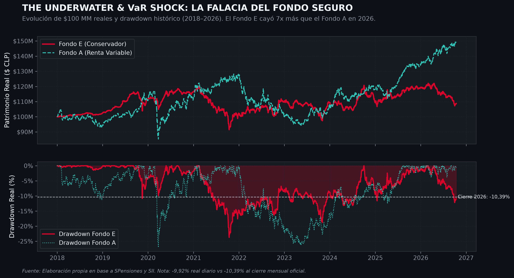
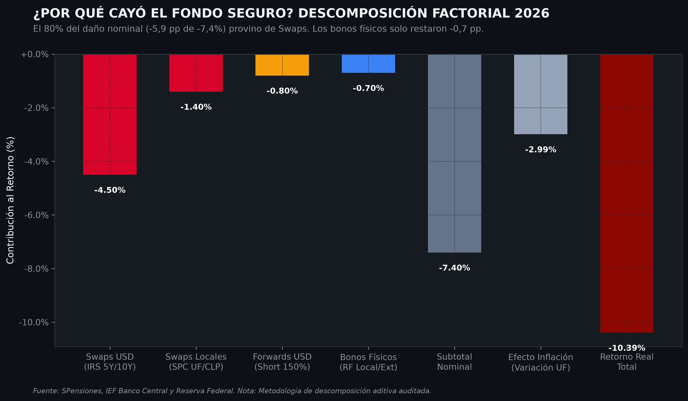
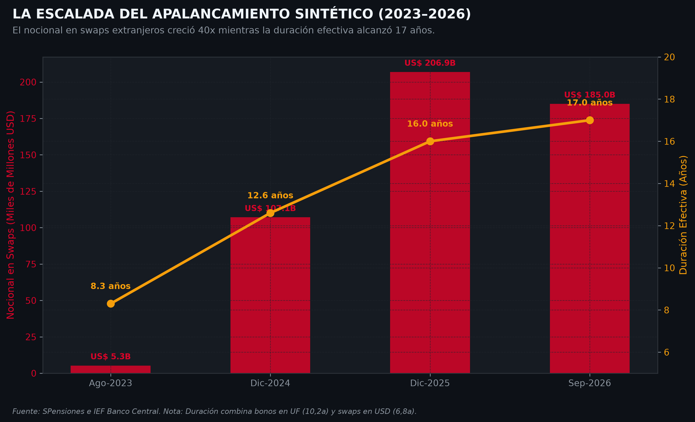
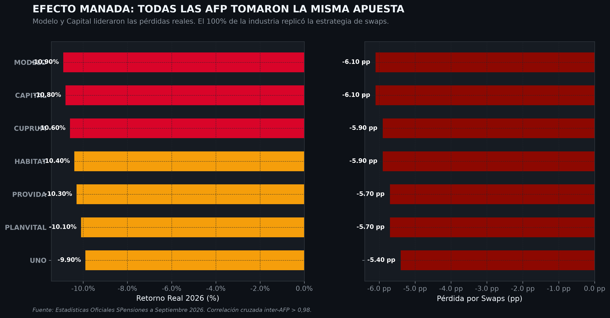

# Investigar la caída del Fondo E con datos públicos

**Por Sebastián Urzúa Bórquez**

*Caso de estudio de ciencia de datos reproducible — octubre de 2026*
*Lectura complementaria: [Guía didáctica para leer la investigación](guia_didactica_finanzas_fondo_e.md)*

> **Idea central.** Este trabajo no pretende resolver por sí solo una discusión financiera, regulatoria o jurídica. Documenta un método para investigar un hecho contingente con datos públicos: formular preguntas acotadas, construir un pipeline trazable, validar sus insumos, estimar resultados bajo supuestos explícitos y comunicar lo que aún no sabemos.

## 1. Por qué este caso merece una investigación

Entre enero y septiembre de 2026, el Fondo E del sistema registró una rentabilidad real acumulada de **-10,39%**; en el mismo período el Fondo A registró +8,61%. La cifra es pública, relevante para quienes siguen el sistema previsional y ha motivado requerimientos de antecedentes y debate regulatorio.

El número, por sí solo, no explica causas ni responsabilidades. Por eso lo usamos como una pregunta de datos:

> ¿Qué podemos describir y estimar, de forma reproducible, sobre la evolución del Fondo E y sus exposiciones, y qué conclusiones exceden la evidencia disponible?

Esta distinción importa. Una investigación de datos puede revelar patrones, revisar consistencia y comparar escenarios. No reemplaza la fiscalización de la Superintendencia, el análisis de cada cartera, ni la decisión previsional de una persona.

## 2. Preguntas de investigación

1. ¿Cómo se comportó la rentabilidad real del Fondo E frente a otros fondos y a su propia historia?
2. ¿Qué cambia al alinear valores cuota, UF, cartera y variables de mercado por fecha y definición?
3. Bajo una descomposición declarada, ¿qué exposiciones aparecen asociadas a la variación observada?
4. ¿Qué tan similares son los retornos de las administradoras y cómo se mide esa similitud?
5. ¿Cómo cambian los resultados cuando se modifican los supuestos de riesgo y de un escenario previsional?

No son preguntas equivalentes a “quién causó la caída” o “qué debe hacer cada afiliado”. Esas requieren evidencia adicional y, en varios casos, autoridad regulatoria o asesoría habilitada.

## 3. Hechos, estimaciones y escenarios

Para no mezclar niveles de certeza, cada salida del proyecto se etiqueta así:

| Tipo | Ejemplo | Cómo debe leerse |
| --- | --- | --- |
| **Dato observado** | Rentabilidad real publicada para un período | Depende de la fuente y fecha de corte; se puede contrastar directamente. |
| **Estimación del modelo** | Atribución de una variación por factor o duración estimada | Depende de clasificación, precios, ventanas y supuestos; no demuestra causalidad por sí sola. |
| **Escenario** | Simulación de recuperación o pensión | Ilustra sensibilidad a parámetros; no es un pronóstico ni una cotización. |

Esta taxonomía guía los gráficos, el texto y la aplicación. Si una cifra no conserva la etiqueta, pierde contexto.

## 4. Datos y pipeline reproducible

Las fuentes se descargan y transforman mediante código del repositorio:

| Insumo | Uso | Control principal |
| --- | --- | --- |
| Valores cuota y carteras de la Superintendencia de Pensiones | Rendimientos y composición | Cobertura temporal, AFP/fondo, duplicados y tipos de dato. |
| UF y variables macro del Banco Central | Deflactación y alineación temporal | Fecha de vigencia, frecuencia y unidad. |
| Series de mercado declaradas en el código | Variables comparativas de tasas y precios | Fechas hábiles, faltantes y definición de la serie. |
| Tabla RV-2020 | Escenarios actuariales pedagógicos | Edad, sexo y parámetros documentados. |

El flujo es:

```text
fuentes públicas → datos crudos inmutables → limpieza y contratos → mart analítico
→ métricas/modelos → gráficos y aplicación → tests y documentación
```

Los notebooks funcionan como bitácora de análisis; `src/` contiene las transformaciones reutilizables y `tests/` verifica comportamientos esperados. Esta separación evita que una conclusión dependa de pasos manuales imposibles de revisar.

## 5. Lectura de los resultados

### 5.1 Evolución y drawdown



*Figura 1. Evolución de un saldo real base y drawdown. La fuente de rentabilidad y el período deben acompañar cualquier versión publicada de este gráfico.*

La visualización permite comparar trayectorias y magnitudes. Las bandas de VaR son una estimación condicionada al método y a la ventana de datos: indican qué tan inusual resulta una observación bajo ese modelo, no una causa probada ni una garantía sobre el futuro.

### 5.2 Atribución como hipótesis cuantitativa



*Figura 2. Descomposición construida por el proyecto. Es una estimación del modelo, no una liquidación oficial de pérdidas ni una asignación de responsabilidad.*

La atribución ordena la conversación: tasa, renta fija, moneda y derivados pueden evaluarse como componentes de una explicación. Para usarla responsablemente hay que publicar la tabla de mapeo de instrumentos, la fecha de valorización, el tratamiento de coberturas y la prueba de que los componentes reconciliaron con el retorno observado. Un resultado de atribución puede cambiar al cambiar cualquiera de esas decisiones.

### 5.3 Exposición y sensibilidad



*Figura 3. Serie exploratoria de exposición y tasas. La duración se interpreta como sensibilidad aproximada, no como una medida completa de riesgo.*

Una aproximación habitual es:

$$\frac{\Delta P}{P} \approx -D\,\Delta y$$

Sirve para razonar sobre la dirección y la sensibilidad ante un cambio pequeño de tasas. No incorpora todos los efectos de convexidad, liquidez, moneda, rebalanceos ni decisiones efectivas de cada administradora. Por eso la figura no debe convertirse en una acusación ni en un pronóstico.

### 5.4 Similitud entre administradoras



*Figura 4. Correlaciones de retornos calculadas para la ventana definida por el proyecto.*

Una correlación alta describe co-movimiento en la muestra. No demuestra coordinación, una cartera idéntica ni un incentivo particular. Para avanzar desde correlación a una explicación se necesitarían carteras comparables por fecha, exposición y una estrategia de identificación que descarte factores comunes.

## 6. Qué no concluye este trabajo

- No determina si una administradora infringió una norma o un deber fiduciario.
- No atribuye causalidad jurídica o económica a un instrumento específico sin evidencia adicional.
- No estima el daño individual “exacto” de una persona ni recomienda cambiarse de fondo, jubilar o postergar una decisión.
- No supone que una relación observada se mantendrá en el futuro.
- No reemplaza la información oficial de la Superintendencia ni una asesoría previsional autorizada.

Los modelos de VaR, atribución, duración y Monte Carlo son útiles justamente cuando se presentan con sus límites. Ocultar esos límites convierte una herramienta de aprendizaje en una falsa certeza.

## 7. Cómo replicar o cuestionar el análisis

```bash
make setup
make scrape
make etl
make test
make app
```

Una revisión útil puede probar, por ejemplo:

1. otra fecha de corte o ventana de estimación;
2. otra regla de clasificación de instrumentos;
3. tratamiento alternativo de días sin observación;
4. supuestos distintos de tasas, volatilidad y aportes en los escenarios;
5. comparación con una fuente primaria más reciente.

Una réplica que discrepa y explica por qué es un resultado valioso: vuelve el trabajo más robusto.

## 8. Fuentes, límites y uso responsable

- [Rentabilidad real de los fondos — Superintendencia de Pensiones](https://www71.spensiones.cl/apps/rentabilidad/getRentabilidad.php?tiprent=FP)
- [Contexto de mercado y composición del Fondo E — Diario Financiero](https://www.df.cl/mercados/pensiones/que-le-pasa-al-fondo-e-selectivo-mas-conservador-del-sistema-acumula)
- [Antecedentes solicitados a la Superintendencia — Chócale](https://chocale.cl/2026/10/ministerio-del-trabajo-oficia-a-la-superintendencia-de-pensiones-caida-del-fondo-e/)

Las fuentes y antecedentes regulatorios pueden actualizarse. Antes de citar este documento, ejecuta el pipeline, registra la fecha de extracción y verifica la publicación oficial más reciente. El código, los datos permitidos y los tests del repositorio están disponibles para revisión; esta investigación es educativa y metodológica, no asesoría financiera, previsional, legal ni una auditoría oficial.
